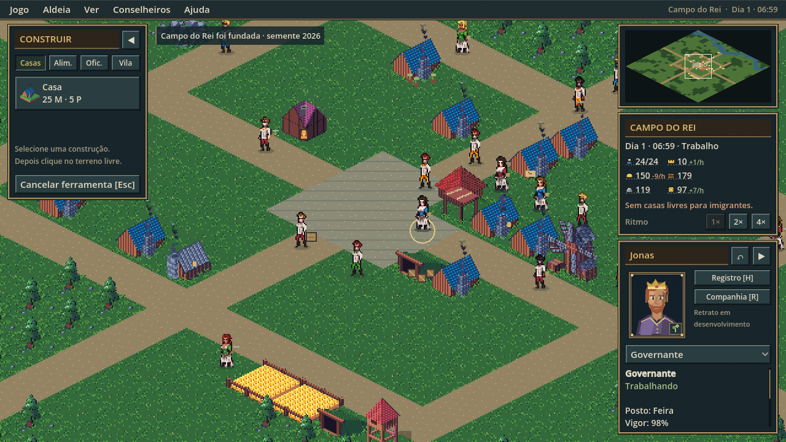
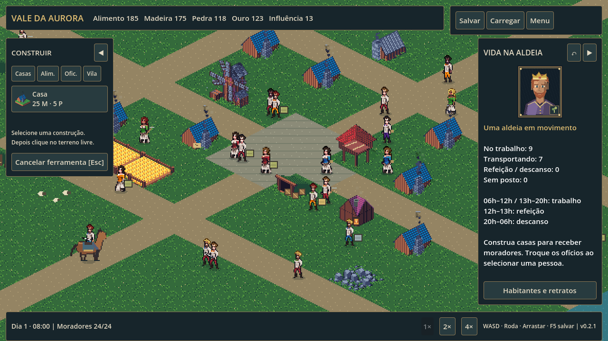

# HalfACiv Isometric v0.4.1 — Política e progressão

Esta atualização recupera o plano original da etapa política, preservando a interface, o minimapa e os mundos por semente da v0.4.0.

Pressione **P** durante a campanha ou use **Conselheiros → Conselho do domínio**. Administre Camponeses, Guildas, Clero e Nobreza, aprove uma decisão por dia, promulgue reformas e evolua de Aldeia até Reino. Custos, efeitos e requisitos aparecem antes de confirmar. O conselho não pausa a economia. Esc fecha a janela; com as janelas fechadas, Espaço alterna a pausa. F5 salva.

Saves anteriores continuam compatíveis: começam com política neutra, sem inventar decisões. A aproximação offline respeita reformas aprovadas e não toma decisões políticas.

[Regras e balanceamento](docs/POLITICS.md) · [Validação](docs/VALIDATION_V0.4.1.md) · [Release](https://github.com/cloudhadock-coder/HalfACiv-Isometric/releases/tag/v0.4.1)

Para executar no Windows 10/11 x64, extraia o ZIP da Release e abra `HalfACiv-Isometric.exe`. Salve e feche a versão antiga antes de abrir a nova; escolha Carregar domínio. Para desenvolver, abra `project.godot` no Godot 4.7.2; os comandos de build/testes existentes estão abaixo. Testes novos: `tests/politics_tests.gd` (janela gráfica) e `tests/realm_campaign.gd` (headless).

Limites: balanceamento político inicial; não há guerras, diplomacia externa ou transformação automática dos sprites da cidade. Oito direções/ciclos próprios de cavalaria e aprovação dos retratos continuam pendentes.

---

## Documentação anterior e demais sistemas preservados

# HalfACiv Isometric v0.4.0

**Interface, menu e mundos por semente:** a tela segue a disposição dos 4X clássicos. No topo fica a barra de menus; na coluna direita, o minimapa clicável, a caixa de status com recursos e tendências e as informações da seleção. A construção virou janela flutuante. O menu principal mostra o domínio salvo, tem atalhos para tudo e cria um mundo aleatório com N ou um mundo personalizado com P (nome, semente, paisagem e recursos, com prévia). Cada semente gera lagos, rio ou costa, florestas, estradas e uma vila acessível. Saves anteriores abrem no mapa clássico.

[Interface e geração de mundo](docs/INTERFACE.md) · [Ideias do Civ2-UI-Additions](docs/UI_ADDITIONS.md) · [Notas da versão](docs/RELEASE_NOTES.md) · [Validação](docs/VALIDATION_V0.4.0.md)

# HalfACiv Isometric v0.3.0

**Cavalaria e personagens:** abra Companhia [R] para contratar especialistas e equipar montarias. São cinco pelagens, seis cores heráldicas, barda, equipamento de cavaleiro e estandarte. Selecione primeiro o cavaleiro ou cavalo no mapa para personalizar. F5 salva equipamento e contratos; saves anteriores continuam compatíveis.

Os contratos especializam os moradores nomeados existentes, evitando duplicação. Os retratos e partes em revisão continuam como fallback. Trote/galope são ritmos de deslocamento do ciclo lateral; animações anatômicas independentes e oito direções permanecem pendentes.

[Notas da versão](docs/RELEASE_NOTES.md) · [Validação](docs/VALIDATION_V0.3.0.md)

# HalfACiv Isometric — v0.2.2

**Vida na aldeia**: estratégia e construção medieval em Godot 4.7.2 / GDScript. Um mapa isométrico real, com moradores que trabalham, fazem refeições, descansam e transportam sua produção.

A **v0.2.2** estabelece o padrão artístico oficial dos retratos: [guia de estilo](docs/PORTRAIT_ART_STYLE_GUIDE.md) derivado de duas folhas de referência, [auditoria](docs/PORTRAIT_AUDIT.md) dos 24 retratos, pipeline de validação e integração em `tools/portrait_pipeline/`, exibição em escala inteira pixel-exata e [galeria de validação](docs/portrait-validation/portrait-gallery.png). Os retratos atuais continuam como fallback pendente; nenhuma arte nova foi desenhada nesta versão.

A **v0.2.1** corrige câmera, zoom, alinhamento, profundidade e UI da v0.2.0. [Relatório detalhado](docs/VISUAL_BUGS_V0.2.1.md) e [capturas reais](docs/visual-validation/v0.2.1/Contact_Sheet.png).

## Executar no Windows
Baixe o ZIP em [GitHub Releases](https://github.com/cloudhadock-coder/HalfACiv-Isometric/releases), extraia e abra **HalfACiv-Isometric.exe**. Windows 10/11 x64; Godot não precisa estar instalado. O build local fica em `dist/v0.2.2/`.

No projeto fonte local, use `Jogar.cmd` ou abra `project.godot` no Godot 4.7.2 e pressione F5. A cópia local da engine está em `tools/godot`. O HalfACiv original não é modificado nem necessário para executar.

## Correções da v0.2.1
Câmera limitada pelo losango e pela área útil, zoom ancorado no cursor, superfície com origem (32,40), sprites nativos com pés alinhados, sombras abaixo dos objetos e vento sem mover o chão. B/I ou as setas recolhem os painéis. Estradas/água/praça não têm furos; o mundo termina num tabuleiro com borda uniforme. Em janelas largas, a vista utiliza a área total. Saves continuam no esquema 2, preservando posições fracionárias.

## Funcionalidades preservadas da v0.2.0
- 24 ofícios e uma comunidade inicial de 24 moradores, além do cavalo. Postos compatíveis têm limite de vagas; ofícios podem ser redistribuídos no inspetor.
- Trabalho de 06h a 12h e de 13h a 20h, refeição ao meio-dia, sono e recuperação de vigor. Guardas patrulham; construtores aceleram obras; carregadores buscam cargas.
- Produção depende da presença no posto. Recursos ficam no local de trabalho até serem entregues ao depósito ou à feira. Forja, padaria, carpintaria e estalagem usam insumos.
- 18 tipos de construção: os seis originais mais moinho, padaria, pesqueiro, forja, carpintaria, herbário, estalagem, depósito, estábulo, pasto, quartel e torre.
- Novas casas permitem imigração gradual, com alimento disponível e limite de 64 moradores. O pesqueiro exige margem de água; obras não podem cortar acessos existentes nem prender moradores.
- 24 retratos de 96×112 pixels (fallback legado, pendentes de redesenho no padrão 64×64), galeria selecionável e identidade visual preservada quando o ofício muda.
- Moinho e bandeiras animados, árvores ao vento, água, fumaça, fogo da forja, cargas visíveis e iluminação conforme o horário.
- Velocidades 1×/2×/4×, resumo da aldeia e inspeção de trabalhadores, insumos e produção em espera.

## Saves e compatibilidade
Saves da v0.1.0 são migrados para o esquema 2. Inventário e moradores são preservados; rotas são recalculadas. A primeira gravação de um save antigo mantém `realm.json.v0.1.bak`, além do backup rotativo `.bak`. Estoques dos postos, cargas, vigor, ofícios, identidade, entregas e horário são salvos. Autosave a cada 60 segundos reais de jogo ativo.

O progresso offline continua limitado a duas horas, com estimativa econômica conservadora de produtividade. Não move NPCs, não gera imigração e não cria decisões políticas.

## Desenvolvimento
Instale Pillow com `python -m pip install Pillow`. A instalação local em `tools/python_libs` também é reconhecida. Use cópias autorizadas do pacote em `assets/original/GandalfHardcore/` e do tileset em `assets/original/sprite-Sheet.png`. Execute `python tools/asset_pipeline/build.py` e importe o projeto no Godot.

Para exportar, mantenha os templates oficiais Windows em `tools/godot/windows_release_x86_64.exe` e `windows_debug_x86_64.exe`.

O pipeline é determinístico. `village_art.py` define roupas, ferramentas, retratos, paleta e adaptações dos edifícios. Os personagens derivados do GandalfHardcore são privados e **não entram no Git**. O repositório público exige que o desenvolvedor forneça seu pacote autorizado; o build já inclui os recursos incorporados.

## Verificação e releases
- `python tests/test_assets.py`
- `python tools/portrait_pipeline/validate.py` e `python tools/portrait_pipeline/generate_atlas.py` (retratos; veja [o pipeline](tools/portrait_pipeline/README.md))
- `Godot_console.exe --path . --script tests/portrait_ui_capture.gd` (retratos pixel-exatos na UI)
- `Godot_console.exe --headless --path . --script tests/test_runner.gd`
- `Godot_console.exe --path . --script tests/integration.gd`
- `Godot_console.exe --headless --path . --script tests/visual_tests.gd`
- `Godot_console.exe --path . --script tests/visual_validation.gd -- --no-save`
- `Godot_console.exe --path . --script tests/benchmark.gd`
- `Godot_console.exe --path . --script tests/interface_capture.gd` (menus, mundos por semente e HUD em 720p/1080p/540p; [interface](docs/INTERFACE.md))
- `python tools/ui_pipeline/build_ui.py` (molduras e ícones da interface em `assets/ui/`)
- `Godot_console.exe --path . --script tests/ui_additions_capture.gd` (capturas da interface; [mapeamento Civ2-UI-Additions](docs/UI_ADDITIONS.md))
- `python scripts/build_release.py` após commit limpo e tag correspondente; os testes são executados novamente antes do empacotamento.

Testes usam saves isolados em `tests/`. Evidências e limites em [docs/VALIDATION.md](docs/VALIDATION.md). Relatório de assets, controles, arquitetura e roadmap também estão em `docs/`.

## Limitações
Personagens ainda têm uma direção lateral; oito direções e cavalaria completa pertencem à v0.3.0. Os 24 retratos são placeholders aguardando arte desenhada à mão no padrão oficial ([pendências](docs/PORTRAIT_AUDIT.md#trabalho-artístico-pendente)); a montaria permanece provisória. Alguns prédios reutilizam bases do tileset com sinais e detalhes próprios. NPCs evitam obstáculos, mas não colidem entre si; casas e postos usam pontos de acesso externos, sem interiores. Não há combate, recrutamento, política, progressão de era ou menu de configurações nesta versão.
