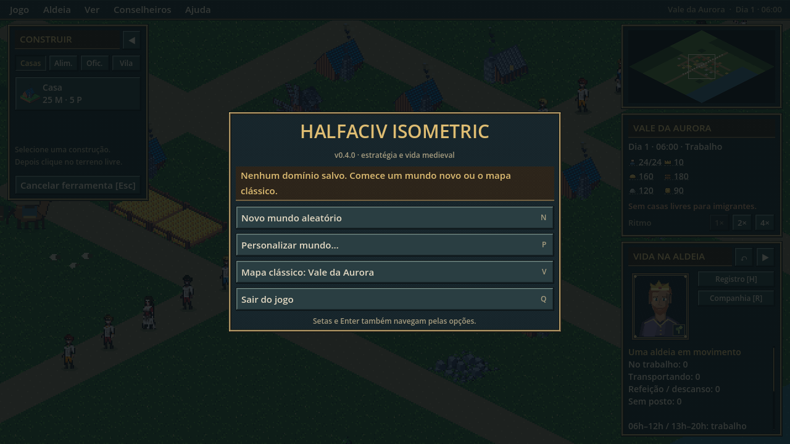
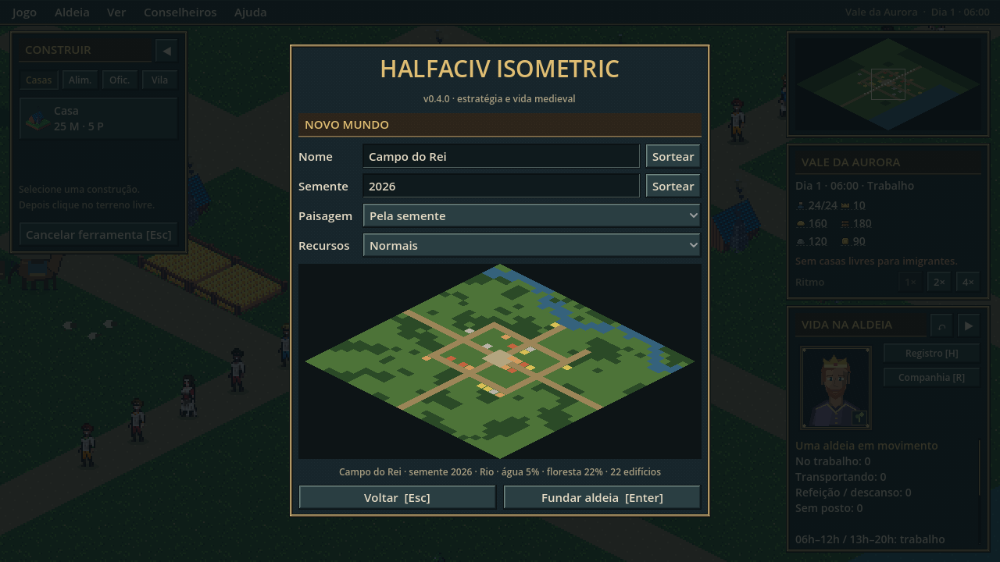
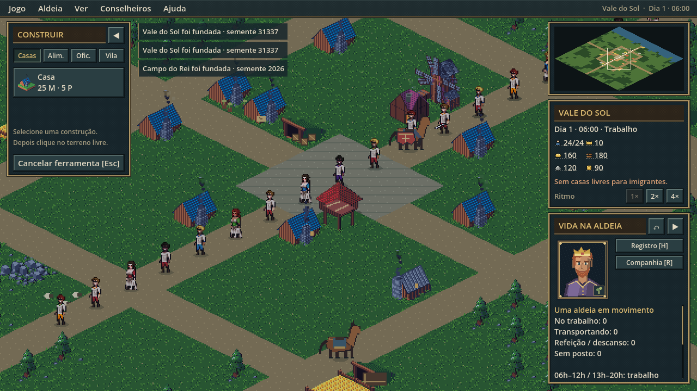

# Interface, menu principal e mundos por semente

A interface segue a **disposição** da tela principal dos 4X clássicos, com Civilization II como referência, mas sem copiar arte nem código. A arte e a paleta são do projeto.

## Disposição

| Região | Conteúdo | Código |
|---|---|---|
| Barra de menus (topo) | **Jogo** (salvar, carregar, novo mundo, menu, sair) · **Aldeia** (construir, companhia, velocidade) · **Ver** (coluna lateral, centralizar, zoom, fixar rotas) · **Conselheiros** (abas do registro) · **Ajuda** (controles). À direita: aldeia, dia e hora. | `src/ui/hud.gd` |
| Coluna direita, topo | **Minimapa**: terreno, prédios por categoria, moradores e o retângulo da câmera. Clique ou arraste para mover a vista. | `src/ui/minimap.gd` |
| Coluna direita, meio | **Status**: nome da aldeia, dia, hora e período, moradores/capacidade, recursos com ícone e tendência por hora, avisos e ritmo 1×/2×/4×. | `src/ui/hud.gd` |
| Coluna direita, base | **Informações** da seleção: retrato, ofício, estado e atalhos para o registro e a companhia. | `src/ui/hud.gd` |
| Janela à esquerda | **Construir**, com categorias, custos e o que falta. Recolhe com B. | `src/ui/hud.gd` |
| Sobre o mapa | Avisos que somem sozinhos, ficha Ctrl e rotas Shift. Veja [UI_ADDITIONS.md](UI_ADDITIONS.md). | |

Com **I** a coluna inteira recolhe e o mapa ocupa a largura; dia e hora continuam na barra de menus.

## Escala de pixels

A janela já é esticada pelo Godot (`canvas_items`, 1,5× em 1080p). O HUD escolhe sua escala para que o fator **final** na tela seja inteiro a partir de 1×: 1080p fica em 1:1 e 1440p em 2×. Assim as molduras não ficam com linhas desiguais. Abaixo de 1280×720, a interface ainda encolhe para caber, com escala fracionária. É o mesmo princípio de `PortraitView`.

## Molduras e ícones (`assets/ui/`)

O script `tools/ui_pipeline/build_ui.py` gera as peças pixel a pixel, de forma determinística (sem filtros, ruído ou reamostragem):

| Arquivo | Tamanho | Margem 9-slice | Uso |
|---|---|---|---|
| `panel.png` | 32×32 | 6 | janelas e painéis, menus suspensos, dicas |
| `bar.png` | 16×16 | 3 | barra de menus |
| `title.png` | 16×16 | 3 | faixas de título (`TitleLabel`) |
| `button_{normal,hover,pressed,disabled}.png` | 16×16 | 3 | botões, seletores, abas |
| `button_field.png` | 16×16 | 3 | campos de texto e trilho da rolagem |
| `grabber.png` | 8×16 | 2 | puxador da rolagem |
| `icon_{food,wood,stone,gold,influence,people}.png` | 12×12 | — | status |

O tema fica em `src/ui/ui_theme.gd`. Para trocar por arte desenhada à mão, mantenha o tamanho e a margem de cada arquivo; nenhum código muda. O `tests/test_assets.py` confere tamanhos e reprodutibilidade. Estas peças são provisórias e não são arte final. Os retratos continuam regidos só por `docs/PORTRAIT_ART_STYLE_GUIDE.md`.

## Ícone do jogo (`assets/icon/`)

O ícone é desenhado à mão em `tools/ui_pipeline/build_icon.py`, ao modo dos ícones de programa dos 4X de meados dos anos 90: contorno escuro, chanfro claro em cima e à esquerda e escuro embaixo e à direita, poucas cores chapadas e um único motivo legível. O motivo é a aldeia do jogo: um bloco isométrico de terra com casa de telhado azul, água e um estandarte. Nenhuma arte de terceiros foi usada.

Os desenhos de 16 e 32 px são feitos separadamente. Os tamanhos 48, 64, 128 e 256 são ampliações inteiras por vizinho mais próximo, sem redução nem reamostragem fracionária. `halfaciv.ico` vai no executável (`export_presets.cfg`) e `icon.png` na janela (`project.godot`). O `tests/test_assets.py` confere cada quadro do ICO pixel a pixel.

## Menu principal

- Um cartão mostra o domínio salvo: nome, dia, moradores e há quanto tempo foi salvo.
- Toda ação tem atalho, e **Enter** executa a primeira: **Continuar** (Enter/C), **Novo mundo aleatório** (N), **Personalizar mundo** (P), **Mapa clássico** (V), **Sair** (Q).
- No jogo, **Esc** abre a versão de pausa: Voltar (Esc), Salvar (F5), Carregar (L) e as mesmas opções de mundo.
- Enquanto o menu está aberto, os atalhos do mapa não agem por trás dele.

**Personalizar mundo:** nome (Sortear), semente (número ou qualquer palavra, com Sortear), paisagem (pela semente, Lagos, Rio ou Costa) e recursos iniciais (Escassos 0,6×, Normais, Fartos 1,6×). A prévia do mapa se atualiza enquanto você digita, junto com a porcentagem de água e floresta. Enter funda a aldeia; Esc volta.

## Geração por semente (`src/world/world_gen.gd`)

- **Determinística:** a mesma semente e as mesmas opções geram sempre o mesmo terreno e a mesma vila. O save guarda só as opções (`"world": {seed, landscape, bounty, name}`) e recria o terreno ao carregar. Saves sem `world` continuam no mapa clássico; o esquema segue 2.
- **Água:** lagos por ruído, rio sinuoso de 2 a 3 tiles ou costa recortada ao longo de uma borda. Se a semente produzir pouca água, um lago garante margem para o pesqueiro.
- **Zona segura:** a praça fica em (15,15), e um raio de 9 tiles ao redor nunca alaga. Estradas em cruz, o anel e a coluna de chegada dos moradores ficam sempre transitáveis.
- **Estradas:** cruz até a água, anel retangular de tamanho variável e um ou dois caminhos que saem dele.
- **Florestas:** manchas por ruído e árvores esparsas fora da vila.
- **Vila inicial:** os mesmos 22 prédios do mapa clássico, distribuídos ao longo das estradas. A feira e o depósito ficam perto da praça, as hortas e o pasto mais longe, a serraria perto da floresta e o pesqueiro na margem. Nenhum prédio pode fechar o último acesso de outro.
- **Validação:** 90 sementes por teste (`tests/test_runner.gd`) verificam acessibilidade de todos os prédios e moradores, margem do pesqueiro, determinismo, salvar e carregar, e rejeição de opções inválidas.

## Verificação

- `Godot_console.exe --path . --script tests/interface_capture.gd`: capturas em 720p, 1080p e 540p, menus, ajuda e as três paisagens, com checagem de que os painéis cabem na janela e de que o HUD cai em pixels inteiros.
- `python tools/ui_pipeline/build_ui.py`: regenera `assets/ui/`.
